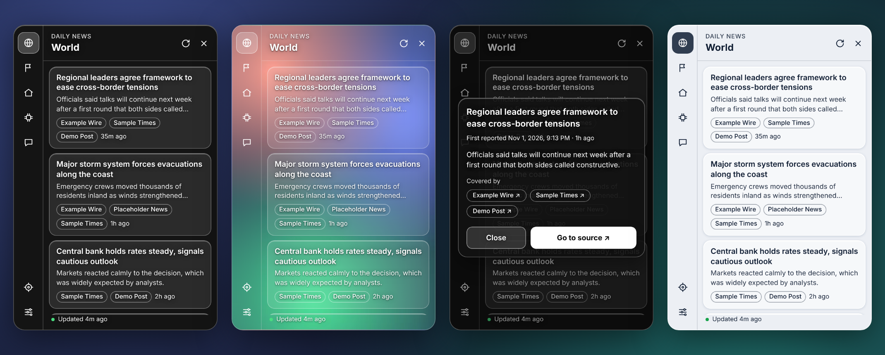
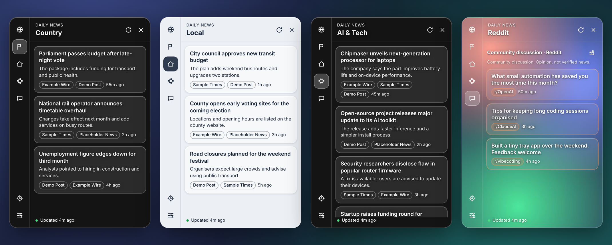
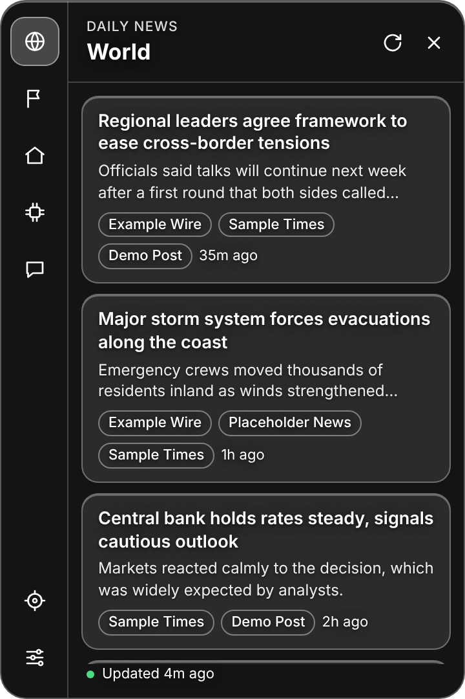
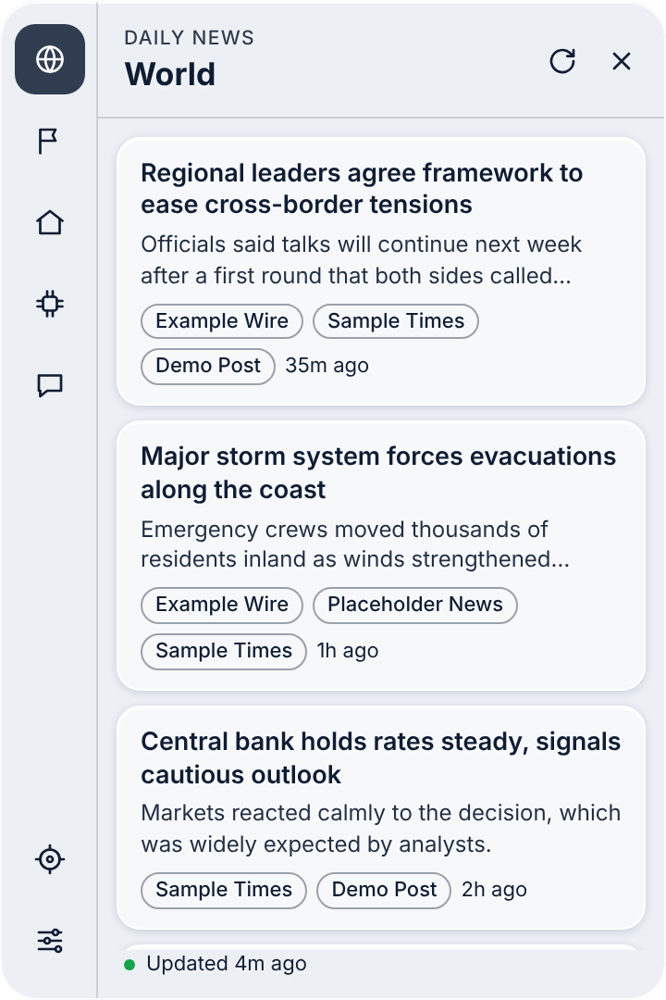
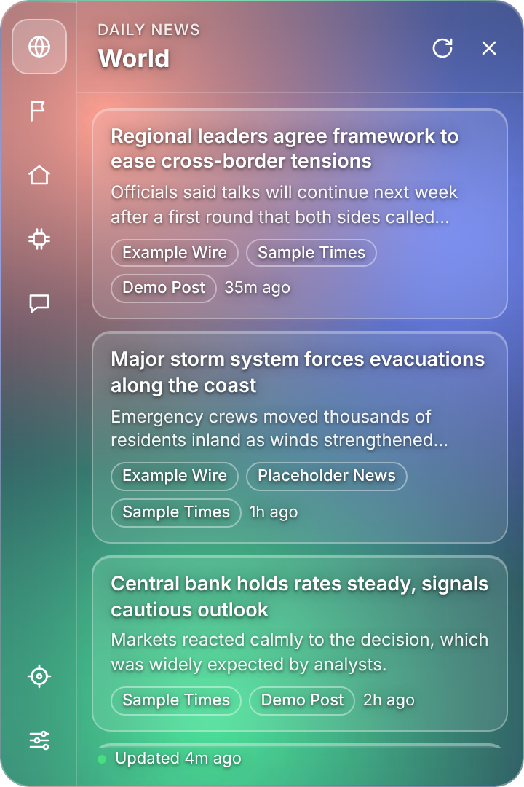
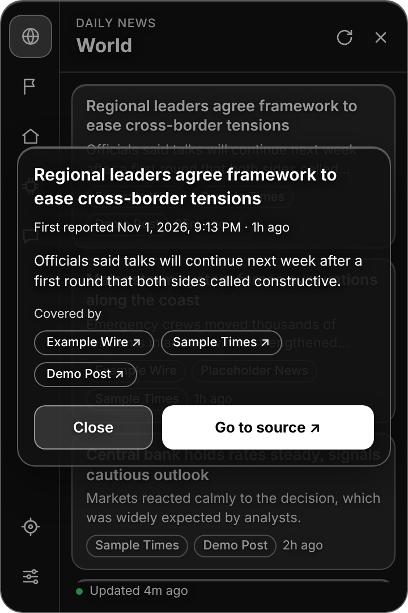
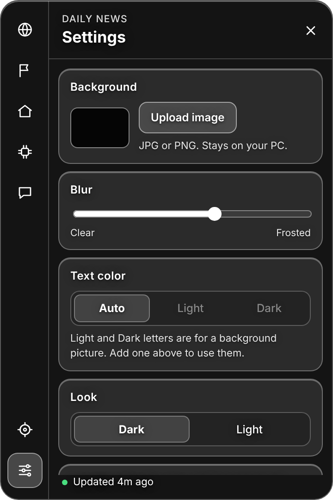
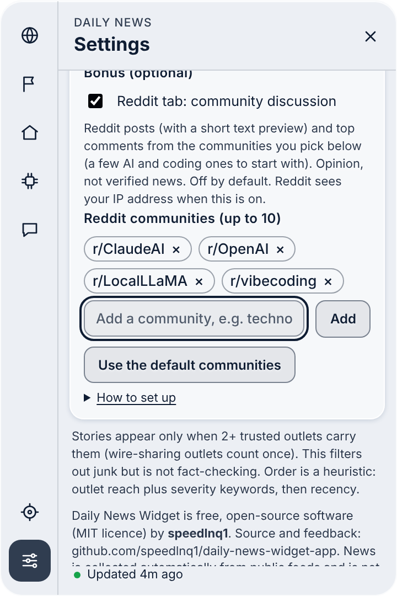

# Daily News Widget

[](https://github.com/speedlnq1/daily-news-widget-app/actions/workflows/build.yml)
[](LICENSE)

<p align="center"></p>

**Ten stories per tab. No feed, no noise, nothing to log in to.** Daily News Widget is a small, free, open-source Windows tray widget that keeps you caught up on **World, Country, Local and AI & Tech** news. It starts with Windows, refreshes through the day, ranks stories by impact, shows only stories that independent outlets agree on, and sends one notification when something big breaks. No account, no API keys, no AI at run time, no tracking.

**Who it is for:** people who want to know what happened without opening a news feed, and who like software they can read and check.

**In 30 seconds:**
1. Install it and pick your country, region and the topics you care about (one question per screen).
2. A glass widget lives in your tray. Open it and press a tab: World, Country, Local, AI & Tech.
3. Click a story for a card with the headline, a short summary, every outlet covering it and a **Go to source** button.
4. If something major breaks and 3+ trusted outlets carry it, you get one notification.

**[Download for Windows](https://github.com/speedlnq1/daily-news-widget-app/releases)** · free · MIT licence · unsigned pre-release (see [Download](#download) for the SmartScreen note)

_Screenshots on this page use made-up sample headlines and outlet names, because real news changes every hour._

> **Status: pre-release.** The installer is not yet code-signed, so Windows will show an "unknown publisher" warning and **auto-update is switched off**. See [Download](#download).

> **The news is automated and is not fact-checked.** The app collects headlines from public RSS feeds of a fixed list of established outlets and ranks them with simple keyword rules. A story shows only if 2 or more independent outlets carry it (a few tabs label single-outlet stories as such). That filters out junk; it does not prove a story true. Always read the source.

> **Paywalls:** the app only reads each outlet's public RSS headline, summary and link. The Straits Times, Sydney Morning Herald, Christian Science Monitor, 404 Media and the NYT can hit a paywall or a free-article limit when you open a story. Singapore's Straits Times and CNA are state-linked, so they count as one source for corroboration, as do outlets that rerun the same wire copy (AP/NPR/PBS/Independent, Global News with CBC, SMH with The Guardian).

## Features

**News**
- **Four tabs, top 10 each.** World, Country, Local and AI & Tech. Press a tab and you are caught up in a minute.
- **Ranked by impact, not by who posted last.** Stories are scored by how many independent outlets carry them plus a keyword-based severity score (war, disasters, elections, markets, laws, model releases, security incidents and so on). Recency is only a tie-breaker. The score is a heuristic, not editorial judgement.
- **Multi-outlet check.** A story shows only if 2 or more independent trusted outlets carry it. Outlets that rerun the same copy count as one source (for example AP/NPR/PBS and The Independent are one wire family; the Singapore state-linked outlets are one). On Country, Local and AI & Tech a few single-outlet stories can fill the list, and they are clearly labelled "single trusted source". This filters junk; it is not fact-checking.
- **Breaking-news alerts.** Every 15 minutes the app checks for a major story that 3+ trusted outlets carry and that was first reported under 6 hours ago, and sends one Windows notification per story.
- **Story card.** Click a story (or press Enter) for its headline, when it was first reported, a short summary from the feed, every outlet covering it and a **Go to source** button. It never downloads the article. Esc closes it.
- **Your place.** A short guided first run asks for your country, region and topics. Country and Local come from hand-picked feeds for many countries plus a trusted-outlet search for every other country (English-language outlets), with a clear message instead of a blank tab when there is no coverage.
- **Topic picking.** Choose the topics you want (war, politics, crime, celebrity, sports, disasters, crypto, finance, business, AI, technology, science, health, everything else). Unwanted topics are removed before the top 10 is chosen, so tabs fill from the best stories that remain, and alerts follow your choices. Pick only a few topics and the widget also reads those topic sections (Sport, Business, Health, Science...) of the same trusted outlets, so narrow picks still fill up.
- **Optional Reddit tab** (off by default, experimental). Top posts of the day from AI and coding communities such as r/ClaudeAI, r/OpenAI and r/LocalLLaMA, read from Reddit's public RSS feeds with no account or API key. Click a post for a card with its text and top comment. It is opinion, not verified news, and is kept apart from the news tabs.

**Look and feel**
- **Glass widget** with a slim side rail for the tabs, Light or Dark theme, an optional background picture (shrunk and kept only on your PC), a blur slider and text-colour control. Bundled Inter font, nothing downloaded.

**Light on your PC**
- **Starts with Windows and lives in the tray.** Closing the window destroys it, so while idle only a small background process remains.
- **Battery-aware schedule.** News is checked every 15 minutes on mains power and every 60 minutes on battery, skipped when you have been idle 30+ minutes, paused while the PC is locked or asleep, and backed off while offline. A full refresh also runs once a day.
- **No AI at run time** and no database. Ranking is plain keyword and counting rules. CI measures idle RAM and CPU of the installed app on every full run.

**Privacy**
- No account, analytics, telemetry or API keys. Settings stay in a local file on your PC. The app only talks to public news feeds (and Google News for some country and local searches). Details: [PRIVACY.md](PRIVACY.md).

More detail on every feature: [docs/GUIDE.md](docs/GUIDE.md).

## Screenshots

<p align="center"></p>

| Dark glass | Light | Your own background picture |
| --- | --- | --- |
|  |  |  |

| Story card | Settings | Pick your Reddit communities |
| --- | --- | --- |
|  |  |  |

## What makes it different

- **It shows ten things, not a feed.** No infinite scroll, no engagement bait, no ads. When you have read the ten, you are done.
- **Corroboration over speed.** Most widgets and aggregators show whatever arrives first. This one waits until independent outlets agree a story exists, and it does not let one wire story pretend to be five.
- **You can read how it decides.** The outlet list (`src/sources.js`), the ranking rules (`src/rank.js`) and the topic keywords (`src/topics.js`) are short, plain files, so you can check, argue with or change them. There is no model to trust.
- **Local and country news that is actually yours.** Country and region are first-class, not an afterthought.
- **Private by construction.** There is no server, no sign-in and nothing to leak, and the code is open for anyone to check that.
- **Small and polite.** Built to sit in the tray without noticing it, and to be gentle on battery.
- **Honest limits.** It is a filter, not a fact-checker; ranking is a heuristic; topic tagging can misfile a story; the Reddit tab is experimental. These are stated up front rather than hidden.

## Download

Installers are published on the [Releases page](https://github.com/speedlnq1/daily-news-widget-app/releases) (latest release: v1.0.3, an unsigned pre-release).

1. Download `Daily-News-Widget-Setup-<version>.exe` and `SHA256SUMS.txt` from the latest release.
2. **Verify it** (optional but recommended). In PowerShell: `Get-FileHash .\Daily-News-Widget-Setup-<version>.exe -Algorithm SHA256` and compare with the line in `SHA256SUMS.txt`.
3. Run the installer. It installs for your user only (no admin rights).
4. **Windows SmartScreen** will probably say *"Windows protected your PC / Unknown publisher"*. That is because the app is not code-signed yet (a signing certificate costs money; applying for free open-source signing is on the [roadmap](#roadmap)). If you trust the source and the checksum matches, choose **More info > Run anyway**. If you would rather not, build it yourself from source (below).
5. **No automatic updates yet.** Until the installer is signed, the app never downloads or runs updates. Install a newer release manually.

## Privacy

No accounts, no analytics, no telemetry. Settings stay in a local file on your PC. The app talks only to public news feeds (and Google News for some country/local searches), so those sites can see your IP address like any website visit. Full details: [PRIVACY.md](PRIVACY.md).

## How it works

Electron main process fetches feeds on a schedule, clusters headlines about the same story, filters by trusted outlet and topic, ranks, and sends only the final lists to a sandboxed renderer. The UI has no network access and no Node integration. See [ARCHITECTURE.md](ARCHITECTURE.md) for the module map and design decisions.

**Tech stack:** Electron, plain JavaScript (no framework, no build step for the UI), `rss-parser`, `electron-builder` (NSIS installer), `electron-updater` (disabled until signed), GitHub Actions on Windows.

## Quality

- Unit tests for ranking, topics, link safety, place matching, Reddit parsing, setup steps and more: `npm test`.
- CI builds the real installer, silent-installs it and runs end-to-end checks on the installed app (startup, restart, corrupt settings, offline, high-DPI), and measures idle RAM and CPU. Those heavy jobs run on `main` and on pull requests labelled `full-ci`.
- A live-feed test fetches real feeds and reports what the ranking would show.
- A 3000-cycle soak test (`npm run soak`) fails if memory grows.
- Security design (sandbox, strict CSP, untrusted feed text, HTTPS-only links, pinned dependencies): [SECURITY.md](SECURITY.md).

Known limits, stated honestly: ranking is a heuristic, topic tagging is keyword-based and can misfile a story, the Reddit tab is unverified on live Reddit, and the app is Windows-only for now.

## Build from source

Requires Node.js 22.

```
npm ci
npm test
npm start          # run the app
npm run dist       # build the Windows installer into dist/ (on Windows)
```

`INSTALL.bat` does the same on a Windows PC for people who just want to run from source. Outlets are listed in `src/sources.js`.

## Roadmap

- Code-sign the installer (apply to the free SignPath Foundation open-source programme, or buy a certificate), then turn on auto-update.
- Screenshots and a short demo GIF in this README.
- More hand-picked country and local feeds.
- Better topic tagging.
- macOS and Linux builds.

## Contributing

Ideas, bug reports and pull requests are welcome: see [CONTRIBUTING.md](CONTRIBUTING.md) and the [Code of Conduct](CODE_OF_CONDUCT.md). To report a security problem privately, see [SECURITY.md](SECURITY.md). Questions, feedback and reviews: open a Feedback issue (there is a template), and a star helps others find it.

## Credits and licence

Made by **speedlnq1** ([github.com/speedlnq1](https://github.com/speedlnq1)). MIT licence, see [LICENSE](LICENSE). News headlines belong to their outlets; the app only links to them. Font: Inter (SIL Open Font License, `src/fonts/Inter-OFL.txt`).
